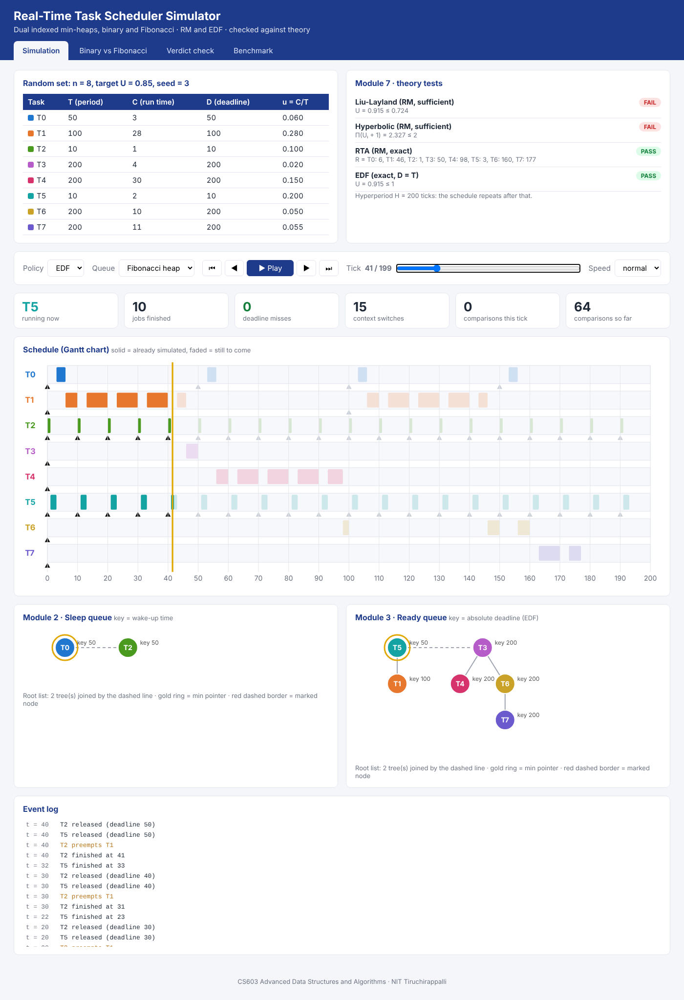
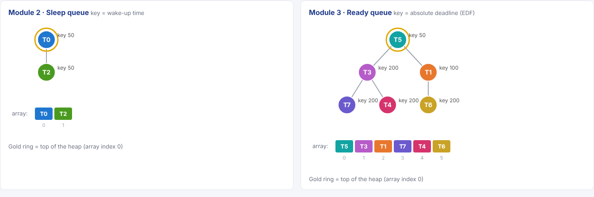
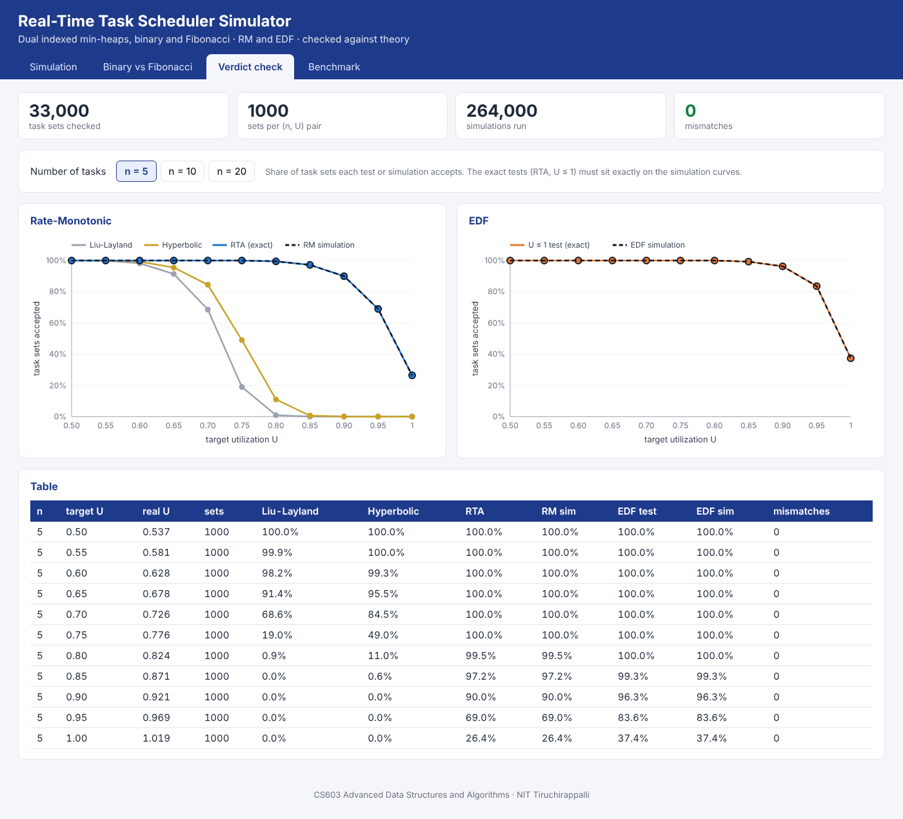
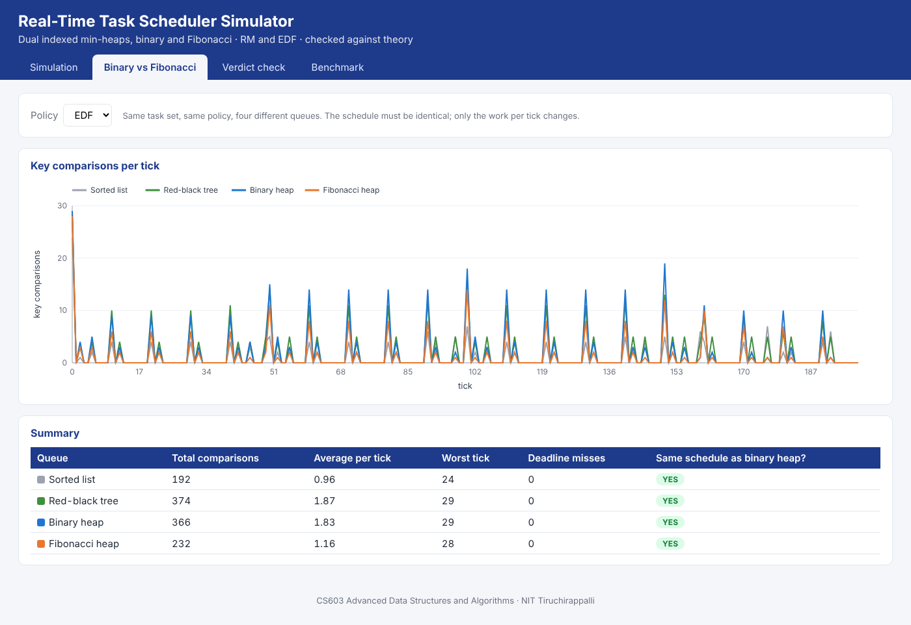
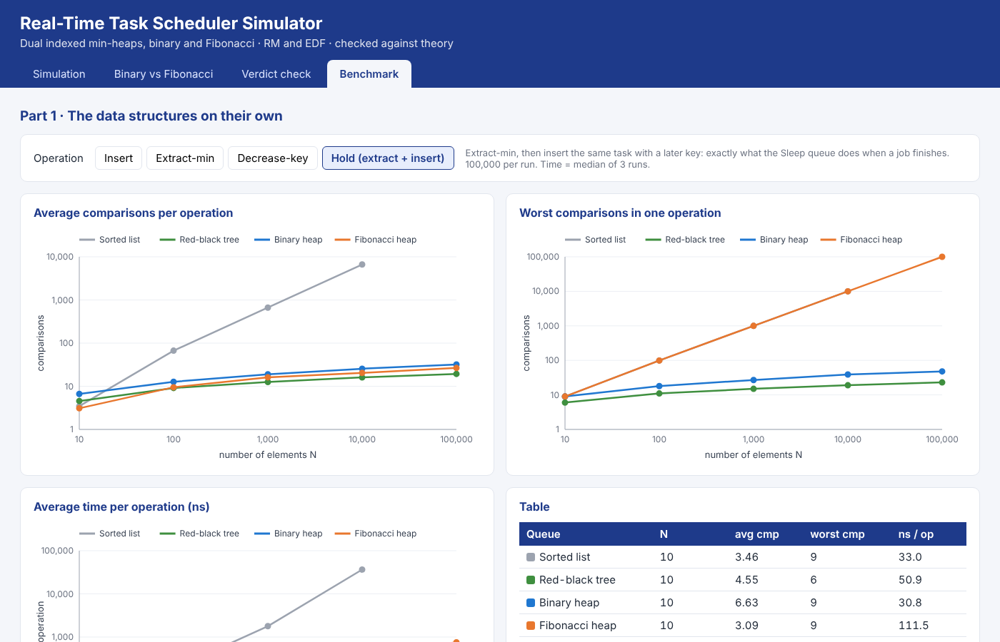

# Real-Time Task Scheduler Simulator using Dual Indexed Min-Heaps (Binary and Fibonacci)

**CS603 Advanced Data Structures and Algorithms, NIT Tiruchirappalli**
Sriram Paranthaman (206126034) · Tejas Mishra (206126035)

Review slides: [first review](docs/RTTS_First_Review.pptx) · [second review](docs/RTTS_Second_Review.pptx) · [final review](docs/RTTS_Final_Review.pptx)
Reports: [test cases](docs/TEST_CASES.md) · [evaluation metrics](docs/EVALUATION_METRICS.md) · [results and analysis](docs/RESULTS_AND_ANALYSIS.md)

A C++17 simulator of a real-time CPU scheduler. Tasks wait in a **Sleep queue** until their next release, then move to a **Ready queue**; every tick the CPU runs the top job. Both queues are built **twice**, as an **indexed binary min-heap** and as a **Fibonacci heap**, and compared with two structures used by real systems: a **sorted list** (FreeRTOS) and a **red-black tree** (Linux). The scheduler supports **Rate-Monotonic (RM)** and **Earliest Deadline First (EDF)**, and every result is checked against exact real-time theory.

The project is built to be **seen**, not just run:

* a **terminal view** with a colour Gantt chart and the heaps drawn as trees, tick by tick;
* a **browser viewer** (no install, no server: just open `viewer/index.html`) that animates the schedule and both heaps, and plots the experiments.



---

## 1. Quick start

You need a C++17 compiler (g++ 8+, clang 7+ or Visual Studio 2019+) and, ideally, CMake 3.14+.

```bash
git clone https://github.com/gusfring3369/DSAProject.git
```

```bash
cd DSAProject
```

```bash
cmake -S . -B build
```

```bash
cmake --build build --config Release
```

```bash
./rtts demo
```

Then open **`viewer/index.html`** in any browser (double-click it). The repository already contains viewer data for the sample task set and the full experiments, so the viewer works even before you build anything.

The executables `rtts` and `rtts_tests` are placed in the project root, so all commands below are run from there.

### Building without CMake

One command is enough:

```bash
g++ -std=c++17 -O2 -Iinclude src/*.cpp src/queues/*.cpp -o rtts
```

### Windows

* **Visual Studio:** *File → Open → Folder…*, pick the project folder, wait for CMake to configure, choose the **Release** configuration and build. `rtts.exe` appears in the project folder. Run it from a terminal opened in that folder: `.\rtts demo`.
* **MinGW / MSYS2:** use the `g++` line above, then `.\rtts.exe demo`.
* Colours and box characters need Windows Terminal or PowerShell on Windows 10+. If the output looks garbled, add `--no-color`.

---

## 2. Commands

| Command | What it shows |
|---|---|
| `./rtts demo` | Task table, the four theory tests, a colour Gantt chart, metrics and the verdict for one task set. Also writes `viewer/data/trace.js` for the browser viewer. |
| `./rtts step` | Walks through the simulation **one tick at a time**: events (release, preemption, finish), the Sleep and Ready heaps drawn as trees, and the Gantt chart so far. Press Enter for the next tick, `q` to stop. |
| `./rtts compare` | Same task set with all four data structures: work per tick and a check that all four produce the same schedule. |
| `./rtts dataset` | Writes the synthetic dataset (UUniFast) to `data/tasksets.csv`. |
| `./rtts verdict` | **Module 8** over the full dataset: 33,000 task sets × RM/EDF × 4 data structures = 264,000 simulations, compared with theory (≈ 10 s). |
| `./rtts operations` | **The data structures on their own**: insert, extract-min, decrease-key and hold, N = 10 … 100,000 (≈ 40 s). |
| `./rtts benchmark` | Cost per tick of each data structure inside the scheduler, 5 … 1000 tasks (< 1 s). |
| `./rtts all` | `demo` + `verdict` + `benchmark` + `operations`. |
| `./rtts help` | All options. |

Useful options:

```text
--policy RM|EDF          scheduling policy
--queue binary|fibonacci|sorted_list|rb_tree
--n 8 --u 0.85 --seed 3  use a random task set instead of the sample set from the slides
--delay 300              step: auto-play, 300 ms per tick
--sets 100               verdict: 100 sets per (n, U) pair instead of 1000 (quick run)
--in data/tasksets.csv   verdict: use a dataset file made by "rtts dataset"
--no-color               plain text (for saving output to a file)
```

Examples:

```bash
./rtts step --queue fibonacci --policy EDF
```

```bash
./rtts demo --n 8 --u 0.85 --seed 3 --policy EDF
```

```bash
./rtts verdict --sets 100
```

---

## 3. The browser viewer

Open `viewer/index.html`. It reads the files the program writes into `viewer/data/`:

| Tab | Content | Re-create with |
|---|---|---|
| **Simulation** | Task set and theory tests; play/pause/step through the schedule; Gantt chart filling in as time moves; the Sleep and Ready queues drawn live (binary heap as a tree plus its array, Fibonacci heap as its root list of trees with the min pointer and marked nodes, sorted list and red-black tree as a sorted chain); event log. Switch policy and queue at any time. | `./rtts demo` (any task-set options) |
| **Binary vs Fibonacci** | Key comparisons per tick for the four data structures on the same task set, and a check that the schedules are identical. | `./rtts demo` |
| **Verdict check** | Share of task sets accepted by Liu-Layland, hyperbolic, RTA, the U ≤ 1 test and the two simulations, per number of tasks. The exact tests lie exactly on the simulation curves. | `./rtts verdict` |
| **Benchmark** | Part 1: each data structure on its own, per operation (insert, extract-min, decrease-key, hold): average and worst comparisons and time. Part 2: cost per scheduler tick against the number of tasks. All log-log. | `./rtts operations`, `./rtts benchmark` |

Keyboard on the Simulation tab: **← / →** step one tick, **Space** play/pause.

| | |
|---|---|
|  |  |
|  |  |

---

## 4. Suggested demo for a review (about 5 minutes)

1. `./rtts demo`: the sample set from the slides. Point out that T2 is preempted at t = 10 and finishes at **28**, exactly the R₂ that RTA predicts.
2. `./rtts step --queue fibonacci`: press Enter a few times. At t = 0 the Fibonacci Ready heap has **three separate one-node trees** (lazy insert); after the first ExtractMin they are **consolidated**.
3. Open `viewer/index.html`, press **Play**, then switch *Queue* between *Binary heap* and *Fibonacci heap* on the same tick to compare their shapes.
4. *Binary vs Fibonacci* tab: same schedule, different work per tick.
5. *Verdict check* tab: 33,000 task sets, **0 mismatches**.
6. *Benchmark* tab, *Hold*: the sorted list grows linearly; the Fibonacci heap does the fewest comparisons on average, but its worst single operation grows like N and it is slower in real time.

---

## 5. Project structure

```text
DSAProject/
├── CMakeLists.txt
├── README.md
├── include/rtts/                  headers (one per module)
│   ├── task.hpp                   Task model: T, C, D and the current job's state
│   ├── queues/
│   │   ├── task_queue.hpp         common interface + QueueView (used for drawing)
│   │   ├── binary_heap.hpp        Modules 2/3, binary version (indexed)
│   │   ├── fibonacci_heap.hpp     Modules 2/3, Fibonacci version
│   │   ├── sorted_list.hpp        existing work: FreeRTOS-style sorted list
│   │   ├── rb_tree_queue.hpp      existing work: red-black tree, as in Linux
│   │   └── queue_factory.hpp      pick a queue by name
│   ├── generator.hpp              Module 1: UUniFast, hyperperiod, sample set
│   ├── scheduler.hpp              Modules 2–5: release, dispatch, completion
│   ├── metrics.hpp                Module 6: Gantt, misses, response times, cost per tick
│   ├── theory.hpp                 Module 7: Liu-Layland, hyperbolic, RTA, EDF
│   ├── verdict.hpp                Module 8: simulator vs theory
│   ├── dataset.hpp                33,000-set dataset, CSV in/out
│   ├── experiments.hpp            verdict experiment + scheduler benchmark
│   ├── op_benchmark.hpp           data-structure benchmark (insert, extract-min, decrease-key, hold)
│   ├── terminal_view.hpp          colour Gantt chart, heap trees, tables
│   └── json_export.hpp            data files for the browser viewer
├── src/                           the matching .cpp files, plus main.cpp (the CLI)
├── tests/                         unit tests (tiny built-in framework, no dependencies)
├── viewer/                        browser viewer: index.html, css/, js/, data/
└── docs/                          review slides, test cases, metrics, results and analysis, screenshots
```

Folders created when you run the program (not in git): `build/`, `data/` (dataset CSV), `results/` (CSV results and `mismatches.txt`).

---

## 6. How it works

### One tick of the simulation (`src/scheduler.cpp`)

```text
for t = 0 .. H-1:
    while Sleep.top.wakeUpTime <= t:         # Module 2 -> 3: release
        task = Sleep.extractMin()
        start a new job (release, absolute deadline, remaining = C)
        Ready.insert(task)
    if Ready is empty: CPU idle               # Module 4: dispatch
    else:
        run Ready.top for one tick
        if its job is done:                   # Module 5: completion
            Ready.extractMin(); check deadline
            task.wakeUpTime = release + period; Sleep.insert(task)
```

Preemption needs no extra code: a more urgent job simply becomes the new top of the Ready heap. Switching RM ↔ EDF only changes the Ready key (period ↔ absolute deadline). Switching between the four data structures only changes which class `makeQueue()` creates.

### The queues

| Operation | Sorted list (FreeRTOS) | Red-black tree (Linux) | Indexed binary heap | Fibonacci heap |
|---|---|---|---|---|
| Insert | O(N) | O(log N) | O(log N) | **O(1)** |
| Top (peek) | O(1) | O(1) | O(1) | O(1) |
| ExtractMin | O(1) | O(1) amortized | O(log N) | O(log N) amortized, **O(N) worst case** |
| Decrease key | O(N) | O(log N) | O(log N) | **O(1)** amortized |
| Remove any task | O(N) | O(1) amortized | O(log N) | O(log N) amortized |
| Find a task | O(N) | O(1) via stored iterator | O(1) via `task->heapPos` | O(1) via `nodes_` map |

* **Indexed binary heap** (`binary_heap.cpp`): an array heap; every task stores its own position (`heapPos`), updated on every swap. That index is what makes "remove any task" O(log N).
* **Fibonacci heap** (`fibonacci_heap.cpp`): a root list of trees. Insert just adds a one-node tree; `extractMin` consolidates trees of equal degree using an array indexed by degree; `decreaseKey` uses cut and cascading cut. Children and roots are kept in `std::vector` to keep the code readable.
* **Red-black tree** (`rb_tree_queue.cpp`): `std::set`, which is a red-black tree in every major C++ library, plus a stored iterator per task.
* Every queue counts its **key comparisons**, the machine-independent cost used in the benchmarks.

### The theory tests (`src/theory.cpp`)

| Test | Policy | Type | Condition |
|---|---|---|---|
| Liu-Layland | RM | sufficient | U ≤ n(2^(1/n) − 1) |
| Hyperbolic | RM | sufficient | Π(Uᵢ + 1) ≤ 2 |
| RTA | RM | exact | Rᵢ = Cᵢ + Σ⌈Rᵢ/Tⱼ⌉Cⱼ ≤ Dᵢ |
| EDF | EDF | exact (D = T) | Σ Cᵢ·(H/Tᵢ) ≤ H, i.e. U ≤ 1 in whole numbers |

### The verdict check (`src/verdict.cpp`)

For every task set: run RM and EDF with **all four** data structures, then require that
1. RM has no misses ⇔ RTA passes, and EDF has no misses ⇔ U ≤ 1;
2. if Liu-Layland or the hyperbolic bound passes, RM has no misses;
3. when RM is schedulable, each task's worst simulated response time **equals** its RTA Rᵢ;
4. all four data structures produce **exactly the same** Gantt chart.

---

## 7. Results

The full write-up with all tables is in **[docs/RESULTS_AND_ANALYSIS.md](docs/RESULTS_AND_ANALYSIS.md)**. Comparison counts are exact; times were measured on an Intel Xeon with g++ 13.3 -O3 and will differ slightly on other machines.

* **Correctness:** 33,000 task sets × RM/EDF × 4 data structures = 264,000 simulations, **0 mismatches** with theory, and all four structures give identical schedules.
* **Insert:** Fibonacci heap exactly 1 comparison; binary heap 2.3 on average (worst 15 at N = 100,000); red-black tree about log₂N; sorted list about N/4.
* **Worst case:** one Fibonacci extract-min right after 100,000 inserts costs **99,998** comparisons; the binary heap's worst is 32.
* **Time:** the binary heap is the fastest in the hold test (extract-min + insert, what the Sleep queue does) from 100 elements up: 254 ns at N = 100,000, against 444 ns (red-black tree) and 754 ns (Fibonacci heap). The sorted list needs 36 µs at N = 10,000.
* **Conclusion:** the indexed binary heap is the best fit for a real-time scheduler; the Fibonacci heap wins on comparison counts but loses on worst case and on real time, as Cormen et al. note for Fibonacci heaps in general.

> **Note on "target U".** C has to be a whole number of ticks, so it is rounded and at least 1 tick. With 20 tasks and periods as short as 10, many tiny tasks get rounded *up*, so the **real** utilization is often well above the target (see the *real U* column in the viewer). That is why only about 82% of n = 20 sets are schedulable even at target U = 0.50. The verdict check uses the real C and T, so it is not affected.

---

## 8. Tests

```bash
./rtts_tests
```

or, with CMake:

```bash
ctest --test-dir build
```

The 26 test cases (TC01 – TC26) cover: every queue against a sorted reference (insert, extract, remove-any, key changes, decrease-key, empty queue); the binary heap's shape and index after 2,000 random operations; Fibonacci lazy insert, consolidation, heap order and the cascading cut; comparison counts; the theory numbers from the slides (U = 0.75, bound 0.780, product 1.95, R = 2, 7, 28); the worked example Gantt chart; EDF vs RM at U = 1; overload detection; identical schedules across queues; the verdict experiment; the CSV round trip; the red-black tree's costs; and a check that the data-structure benchmark matches the textbook bounds.

The full list with inputs and expected results is in [docs/TEST_CASES.md](docs/TEST_CASES.md); the metrics we evaluate are defined in [docs/EVALUATION_METRICS.md](docs/EVALUATION_METRICS.md).

---

## 9. Assumptions and limits

* Discrete time: one tick is the smallest unit, and C, T and D are whole ticks.
* Single CPU, preemptive, independent periodic tasks, D = T, all released together at t = 0 (the critical instant). Simulating one hyperperiod from there is enough for the exact verdict.
* The scheduler's own run time is measured (benchmark), but it is not added to the simulated task time.
* A job that misses its deadline keeps running; the task's next job is released when the late one finishes.

## 10. References

1. C. L. Liu and J. W. Layland, "Scheduling Algorithms for Multiprogramming in a Hard-Real-Time Environment," *Journal of the ACM*, 20(1), 1973.
2. N. Baudis, F. Jacob and P. Andelfinger, "Performance Evaluation of Priority Queues for Fine-Grained Parallel Tasks on GPUs," *IEEE MASCOTS*, 2017.
3. I. Zagan and V. G. Găitan, "Designing a Custom CPU Architecture Based on Hardware RTOS and Dynamic Preemptive Scheduler," *Mathematics*, 10(15), 2022.
4. M. L. Fredman and R. E. Tarjan, "Fibonacci Heaps and Their Uses in Improved Network Optimization Algorithms," *Journal of the ACM*, 34(3), 1987.
5. E. Bini and G. C. Buttazzo, "Measuring the Performance of Schedulability Tests," *Real-Time Systems*, 30, 2005 (UUniFast).
6. E. Bini, G. C. Buttazzo and G. M. Buttazzo, "Rate Monotonic Analysis: The Hyperbolic Bound," *IEEE Transactions on Computers*, 52(7), 2003.
7. T. H. Cormen, C. E. Leiserson, R. L. Rivest and C. Stein, *Introduction to Algorithms*, 3rd ed., MIT Press, 2009 (Ch. 6 Heapsort, Ch. 13 Red-Black Trees, Ch. 19 Fibonacci Heaps).
8. J. G. Vaucher and P. Duval, "A Comparison of Simulation Event List Algorithms," *Communications of the ACM*, 18(4), 1975 (hold model).
9. D. W. Jones, "An Empirical Comparison of Priority-Queue and Event-Set Implementations," *Communications of the ACM*, 29(4), 1986.
